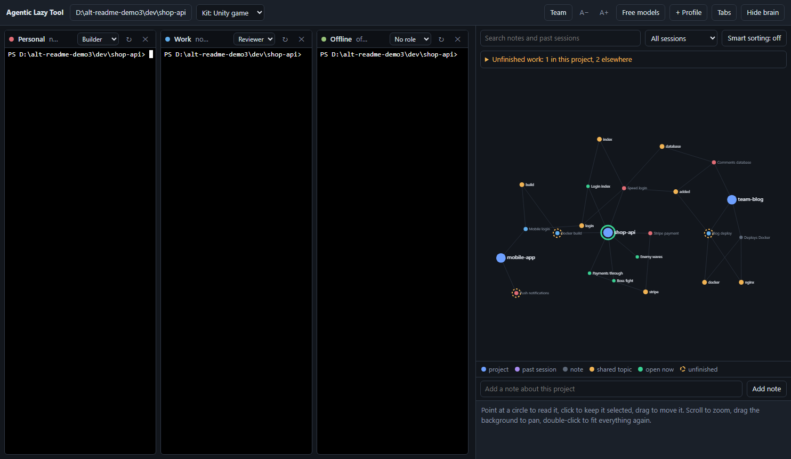

# Recontech Agentic Tool

**One window for all your Claude Code work, with a memory that never forgets.**

## What it is for

Every Claude Code session starts from zero. What you decided yesterday, why a bug happened last week, how a project is deployed: it is all in old sessions that the next session cannot see. And if you use more than one Claude Code sign-in, or need to keep working without internet, you juggle several terminals by hand.

Recontech Agentic Tool puts your Claude Code terminals side by side in one window and connects all of them to a shared local **brain**. The brain is built from your past sessions and the notes Claude saves while it works, so every new session can pick up where the last one left off.

## Main features

- **Claude Code side by side:** up to 6 terminals in a grid or tabs, each running the real Claude Code with its own sign-in (for example Personal and Work).
- **Shared brain:** every terminal connects to the same local memory. A fact one session learns, the next session knows, across profiles and projects.
- **Past sessions become memory:** the brain reads the sessions Claude Code saves on your disk and keeps each one's title, project, your prompts and its main topics, even after Claude Code's own files are gone.
- **See your brain:** a live network beside the terminals shows your projects, past sessions (coloured by profile), notes and the topics that link them. It arranges itself so nothing overlaps and zooms to fit as it grows.
- **Terminals that work together:** ask one terminal's Claude to read another terminal, hand it a task, or discuss an approach with it. For example: "ask the Work terminal to review this change and report back".
- **Resume anything:** click a past session and press **Resume** to continue it in the right terminal and folder.
- **Search everything:** find any earlier decision or session across all projects, by words or, with a small local model, by meaning.
- **Roles:** make one terminal the Manager, others the Builder, Reviewer or Tester, and they hand work to each other. Make roles of your own in the role manager.
- **Hey Recon:** turn on the voice assistant, say "Hey Recon" and your request, and it goes to your Manager terminal. Speech is recognised on your computer.
- **Token usage:** tokens used this week, this month, this year and in total above the graph, and under every terminal its own weekly usage, its current 5-hour session (as bars toward budgets you set) and whether Claude Code said it reached a limit.
- **Project kits:** the app recognises website, mobile, Unity and Godot projects and gives Claude the right working rules for each.
- **Team memory:** write a project's notes to a file in the project so teammates can import them.
- **Unfinished work list:** what was left unfinished, with one click to resume.
- **Smart sorting (optional):** a local model labels every session as bug fix, feature, refactor, setup and deploy, tests, docs or question, and spots work that was left unfinished. Claude is told about unfinished work first, and the graph can show only unfinished sessions or one kind of work.
- **Free models when you hit a limit:** a special terminal runs Claude Code on free AI providers (Gemini, OpenRouter, Cerebras, Groq) with your own free keys. It is kept in a container, so the free AI only sees what you hand it. When a Claude profile reaches its usage limit, a bar offers to open it.
- **Works offline:** an Ollama profile runs Claude Code on a model on your own computer, with the same brain, when there is no internet.
- **Private by design:** everything stays on your computer, secrets are masked before anything is stored, and the app never sees your Claude sign-in.



*The screenshot uses made-up demo projects.*

Website: https://erlruben.github.io/recontech-agentic-tool/

## Install (Windows)

1. Install Claude Code if you do not have it: https://docs.claude.com/en/docs/claude-code
2. Download `RecontechAgenticTool-Setup.exe` from the [latest release](https://github.com/erlruben/recontech-agentic-tool/releases/latest) and run it. It installs for your user only; no admin rights needed.
3. Open **Recontech Agentic Tool** from the Start menu.

Windows may show "Windows protected your PC" because the app is new and not code-signed. Click **More info**, then **Run anyway**.

## Use it

1. Click **Choose project folder**. Every terminal starts there; no terminal starts until a folder is chosen. The first time Claude Code opens a folder it asks whether you trust it: choose **Yes** for your own projects.
2. The first terminal (Main) runs Claude Code with your normal sign-in.
3. Click **+ Profile** to add another, for example Work. Its terminal asks you to sign in to Claude Code the first time; after that it stays signed in. If you already have signed-in Claude Code folders such as `~/.claude-account1`, the app finds them and shows a bar at the top offering to add them as profiles with their existing sign-ins. **+ Profile** also lists any that are not used yet.
4. Work as usual. Claude sees the brain as tools named `remember`, `recall`, `project_memory` and `forget`, and is told to check the project's memory when it starts and to save decisions as it goes. You can also ask it directly: "remember that we deploy with Docker", "what did we decide about the login page last week?"
5. Use the search box above the graph to find anything from earlier sessions or notes, across all projects.

An **Offline** badge appears in the top bar when Claude cannot be reached; Claude profiles then show "needs internet".

Buttons: **↻** restarts a terminal, **✕** removes a profile (its sign-in and past sessions stay on disk), **Tabs/Grid** switches the layout, **Hide brain** gives the terminals the whole window.

**Arranging terminals:** drag a terminal by its title bar onto another terminal. A highlight shows where it will go: drop it on one side to put it there, beside or above or below the other one, or in the middle to swap the two. Drag the gap between two terminals to resize them. Dragging a tab onto the open terminal works the same way and switches to the grid. The arrangement is remembered. A file opened from the Files panel shows above the terminals; drag the bar between them to share the height.

### Roles

A role is the standing job a terminal is given when it starts. Pick one from the role menu in the terminal's title bar. The app adds the role's instructions to Claude Code's system prompt, and every terminal's `list_terminals` shows which role each terminal has, so the terminals know whom to ask for what.

Built-in roles:

- The **Manager** plans and hands out the work; it does not write code. Tell it what you want: it splits the request into tasks and sends each one to a Builder, Reviewer or Tester terminal with `message_terminal`. It then passes finished work on for review or testing, sends the findings back, and tells you what is done and what is still open.
- The **Builder** writes the code, then asks a Reviewer or Tester terminal to check it and fixes what they report.
- The **Reviewer** reads the changes it is asked about and answers with problems and fixes; it does not rewrite the code.
- The **Tester** runs and writes tests and reports exactly what failed.

A typical setup is a Manager in one terminal and a Builder and a Reviewer in two others: you talk to the Manager, and the work moves between the terminals without you carrying messages.

**Your own roles.** Click **Roles** in the header, or choose **Manage roles…** at the end of any terminal's role menu, to open the role manager. There you can:

- **New role:** give it a name and write its instructions to Claude Code (up to 2000 characters), for example a Documenter that keeps the docs in step with the code.
- **Copy as new:** start from a built-in role and change it. Built-in roles themselves cannot be changed or deleted.
- **Save** changes to a role of your own. Renaming keeps it on the terminals that have it.
- **Delete** a role of your own. Terminals that had it are left with no role.

Role names must be unique, ignoring case, and cannot repeat a built-in name. Instructions are kept on one line; double quotes, backticks, dollar signs and curly quotes become plain `'`, so the text is always passed to Claude Code safely. Your roles are saved in `workspace.json` in the app's data folder.

A new or changed role takes effect when that terminal restarts (↻); the app tells you which running terminals are affected.

### Hey Recon

Click **🎙 Hey Recon** in the header to turn on the voice assistant; click it again (or ✕ in its panel) to turn it off. While it is on, the microphone listens for the words "Hey Recon". Say them, then your request, in one breath or after a pause: "Hey Recon, ask the Builder to add a logout button". The request goes to the terminal with the **Manager** role, which answers back. The answer is read out and shown in the Hey Recon panel, and it waits for you to confirm before anything goes into a terminal.

- One terminal needs the Manager role and must be running. Talking to the Manager terminal itself is not needed; type to it.
- Speech is turned into text on your computer with a small Whisper model, and nothing is recorded while no one is speaking. Only the request itself reaches Claude, as a message to the Manager.

### Token usage

**Tokens used**, above the graph, shows how many Claude tokens all your Claude profiles used **this week** (from Monday), **this month**, **this year** and in **total**. The totals count input, output and tokens written to the cache. Tokens read back from the cache are left out: Claude reads the whole earlier conversation back from its cache on each turn, so they would make up nearly all of a total and drown out the work itself. Point at a tile for input, output and both cache figures. Click the heading to fold the panel away.

Under each Claude terminal, a thin bar shows that terminal's own usage:

- **Week:** its tokens this week.
- **Session:** its tokens in the current 5-hour session window and when the window ends. Claude's session limits count in windows like this one; the window is estimated from message times.
- **Limit:** **Within limit**, **Near limit** or **Limit reached**, with the reset time, as Claude Code last printed in that terminal. It clears once Claude answers there again.

**Budgets.** To see Week and Session as bars, type a budget into the **Budget** row under the tiles: one for a **Session**, one for a **Week**, as a number of tokens such as `2M`, `500K` or `2,000,000`. Use your plan's figures or what you want to stay under. Every Claude terminal's bar then fills toward them ("Session 340K of 2M"): amber from 80%, red at 100% or more. The budgets apply to all Claude terminals and are saved with your workspace; leave a box empty for no bar.

The numbers come from the usage figures Claude Code writes into its own session files on your computer, counted once each, and nothing is sent anywhere. Your plan's actual limits are not stored on your computer, so the app can show how much was used, what Claude Code said and how it compares with your own budgets, but not a percentage of your real limit. Ollama and Free models terminals are not counted.

### Project kits

Next to the folder button is the **Kit** menu. The app looks at the files in your project folder and picks a kit: **Website**, **Mobile app**, **Unity game**, **Godot game**, or **General**. A kit is a short set of working rules for that kind of project. The Unity kit, for example, tells Claude to check the Unity and package versions before using an API, never to hand-edit scene, prefab or meta files, and to say what to do in the Editor to test a change. You can pick a different kit by hand; the choice is remembered per project and applies when a terminal starts.

### Team memory

Click **Team** to share what the brain knows about a project:

- **Write the share file** saves the project's notes and the titles of unfinished work to `.alt-brain.json` in the project folder. Commit it with the project.
- A teammate who opens the project in this app sees a bar offering the notes they do not have yet. **Import** adds them to their own brain.
- Conversations and prompts are never included, and secrets are masked. Anyone who can read the project can read the file, so do not share notes you want kept private.

### Notes and unfinished work

- Type in **Add a note about this project** under the graph to save a note yourself. Click a note in the graph and press **Delete this note** to remove it. The same fact is not stored twice.
- Click a past session in the graph and press **Remove from brain** to take it out of the graph and search. Claude Code's own session file is kept, and the session comes back if you continue it.
- With Smart sorting on, **Unfinished work** above the graph lists the sessions that ended unfinished, this project's first, each with a **Resume** button.

### Comfort

- **A−** and **A+** change the terminal text size.
- Drag the line between the terminals and the brain to resize the brain panel.
- **Ctrl+Alt+1** to **Ctrl+Alt+6** switch to a terminal; **Ctrl+Alt+B** shows or hides the brain. AltGr does not count as Ctrl+Alt here, so it still types characters such as { and [ on European keyboards.
- When a newer version is published, a bar at the top offers the download page. The check asks GitHub only for the latest version number.

### Terminals working together

Every terminal's Claude can see and reach the others in the window. Refer to a terminal by the name in its title bar:

- "What is the Work terminal doing?" reads that terminal's screen.
- "Ask Account 1 to review the login fix and tell me what it thinks" sends it a message. The message arrives there as a prompt, that Claude acts on it, and its answer comes back the same way. The receiving terminal's border lights up when a message arrives.
- "Run the tests here, then discuss the failures with the Work terminal and agree on a fix" lets two sessions go back and forth.

Things to know:

- Both terminals must be started, and sessions that were already open before you updated the app must be restarted (↻) once to get this ability.
- Every message uses Claude usage on both sides. One terminal can send another at most 12 messages per 15 minutes; after that it stops and asks you how to continue.
- Everything they say to each other is visible in the terminals.

### About accounts

Each terminal's title bar shows the email its Claude Code is signed in with, and warns when two profiles use the same account.

Claude Code signs in through your web browser, and the browser approves whichever claude.ai account it is already signed in to. To sign a profile in to a different account, type `/logout` and then `/login` in its terminal, copy the sign-in link into a private browser window, and sign in there with the account you want.

Each profile is a separate Claude Code sign-in. Use your own accounts, for example a personal and a work account. Sharing or borrowing someone else's Claude account breaks Anthropic's terms and puts that account at risk. The app does not switch accounts for you when a usage limit is reached.

## Free models terminal

For when a Claude profile reaches its usage limit and you want to keep going.

1. Click **Free models** at the top and paste a free API key for at least one provider. Each row says where to get the key. Google Gemini has the most generous free tier and is the best first choice.
2. Click **Test keys** to check each key and model name, then **Save and enable**. A **Free models** terminal appears. It does not start by itself.
3. When a Claude terminal prints that its limit was reached, a bar appears at the top: click **Open the Free terminal**. You can also start it any time with its **Start the free terminal** button.
4. Give it what it should work on: type or paste into it, or have another terminal send it a message ("ask the Free models terminal to draft unit tests for this function: ..."). It answers back the same way.

### The container

By default the free terminal is kept in a container, so a free AI provider only ever sees what you deliberately hand it:

- It starts in its own empty folder, not in your project, and its file tools cannot leave that folder.
- It cannot run commands, fetch web pages or search the web.
- It has no access to the brain's memory and cannot read other terminals' screens.
- It can do two things with other terminals: see their names and exchange messages. What another terminal chooses to send it is the only project information it gets.

The container is built from Claude Code's restricted mode plus the app's own limits. It is a strong fence inside the app, not an operating-system sandbox.

You can turn the container off in **Free models** if you want free models to work directly in your project with full access. The terminal's title bar then says so in orange.

How it works and what to expect:

- Claude Code in that terminal talks to a small bridge inside the app, which translates each request for the free provider. Providers are tried from top to bottom, and the next one takes over when one is rate limited, out of quota or failing.
- Free models are weaker and slower than Claude, and their free tiers are limited. Claude Code sends long instructions with every request, which some free tiers (Groq's in particular) cannot fit.
- Model names and free tiers change often. If **Test keys** reports a model problem, type a current model name from the provider's site into the model box.
- **Your own provider:** the last row takes any service with an OpenAI-compatible API (address, optional key, model), including one running on your own computer or network. It is tried after the others.
- Your keys are encrypted with your operating system's own protection and stored only on your computer. They are sent only to their own provider.
- Whatever reaches that terminal goes to the free provider that answers, under that provider's terms, not to Anthropic. With the container on, that is only what you type, paste or send it.

## Privacy

**What stays on your computer, always.** The app has no server and no account, and it sends nothing to its authors or to other users. Your sessions, memory notes, profiles, settings and API keys exist only on your computer, so every person who installs the app has their own separate, private setup.

**What goes to an AI provider.** An AI can only answer what it is sent. Whatever a terminal works on goes to the provider behind that terminal: your prompts, the files Claude Code reads, the project's memory notes, and anything it reads from another terminal.

| Terminal | Where its requests go | What the provider may do with them |
|---|---|---|
| Claude profile | Anthropic, through Claude Code | Governed by your Claude plan and its privacy settings |
| Free models (in its container, the default) | The free provider that answers | It only receives what you type, paste or send to that terminal; that is governed by the provider's terms |
| Free models (container off) | The free provider that answers | It receives everything the terminal works on in your project; free tiers often allow more use of your data |
| Ollama (offline) | Nowhere; it runs on your computer | Nothing leaves the computer |

What the app does about it:

- The free terminal is kept in a container by default: no project files, no memory, no reading of other terminals.
- The Free models dialog shows each provider's privacy note, and the free terminal asks for confirmation before it first starts.
- Requests to OpenRouter carry the instruction to use only providers that do not keep or train on your data.
- API keys are encrypted with your operating system's own protection, and secrets are masked before anything is stored in memory.
- For work that must not leave your computer, use an Ollama profile.

The app cannot control what a provider does with data once it has been sent, so read the terms of any provider you add.

## Offline with Ollama

1. Install [Ollama](https://ollama.com/download) and, while online, download a model that can use tools, for example `ollama pull qwen3:8b` (about 5 GB) or `ollama pull qwen3-coder:30b` (about 19 GB, much better, needs a strong PC). Very small models such as `qwen3:0.6b` start, but cannot use tools or the brain.
2. Click **+ Profile**, choose **Offline with Ollama**, and pick the model.
3. That terminal runs Claude Code against Ollama on your computer. It needs no internet and no Claude account, and it uses the same brain.

Claude Code sends a long set of instructions with every request, so give Ollama a larger context: set the environment variable `OLLAMA_CONTEXT_LENGTH` to `32768` or more and restart Ollama. Answers from local models are slower and weaker than Claude's.

## Smart sorting

Smart sorting is off until you turn it on with the **Smart sorting** button above the graph.

- It uses [Laya](https://github.com/receptron/laya), an open-source classification model that runs on your computer. Nothing is sent anywhere, and it works offline.
- The first time, it downloads the model once: about 1.7 GB. If the drive it would use has less than 2.5 GB free, the app asks you to choose a folder on another drive. It uses about 2 GB of memory while it runs.
- For each session it answers three questions: what kind of work it was, whether it was finished, and whether it records a decision worth remembering. A session is sorted once it has been quiet for 10 minutes, and again if you continue it later.
- After the app starts, loading the model can take a minute or two; then each session takes a few seconds. It runs in the background, so you can keep working.
- Sessions that look unfinished get a dashed orange ring in the graph, and `project_memory` lists them first so Claude picks them up. Use the menu next to the search box to show only unfinished sessions or one kind of work.
- The kind of work is judged from the start of a session (title, topics and your first prompts), and finished-or-not from how it ended (your last message and Claude's last reply). The model understands English best, and its labels are estimates.

## How the brain works

| Part | Where it lives | What it holds |
|---|---|---|
| Past sessions | read from each profile's Claude Code folder, indexed in `~/.recontech-agentic-tool/brain/sessions.json` | title, project folder, dates, your prompts, main topics |
| Notes | `~/.recontech-agentic-tool/memory/<project>/notes.jsonl` | short facts Claude or you saved with `remember` |
| Profiles | `~/.recontech-agentic-tool/workspace.json`, sign-ins in `~/.recontech-agentic-tool/profiles/` | which Claude Code sign-ins you use |
| Smart sorting labels | `~/.recontech-agentic-tool/brain/labels.json`, model in `~/.recontech-agentic-tool/models/` or the folder you chose | each session's kind of work and whether it was finished |

- Notes and sessions are linked by the words they share, which is how the topics in the graph appear. It is a searchable memory, not a trained neural network.
- **Search by meaning:** if [Ollama](https://ollama.com/download) is running with the `nomic-embed-text` model (`ollama pull nomic-embed-text`, about 270 MB), search and Claude's `recall` also find things by meaning, so "how do we ship the site" finds the deploy session. It runs on your computer. Without it, search matches words.
- API keys, tokens and `password=...` values are masked before anything is stored.
- The brain checks for new sessions every 10 seconds while the app is open.
- To use the brain in a Claude Code you start yourself, run `claude --mcp-config "%USERPROFILE%\.recontech-agentic-tool\brain\mcp.json"`. The file is written the first time the app starts a terminal.

## Build from source

Requires Node.js 22 or newer.

```
git clone https://github.com/erlruben/recontech-agentic-tool
cd recontech-agentic-tool
npm install
npm start          # run the app
npm test           # run the tests
npm run dist       # build release/RecontechAgenticTool-Setup-<version>.exe
```

macOS and Linux run from source with `npm start`; only the Windows installer is built automatically.

## Contributing

See [CONTRIBUTING.md](CONTRIBUTING.md).

## License

[MIT](LICENSE). You may use, copy, change and share it, including in commercial work, as long as the license notice stays with it.
